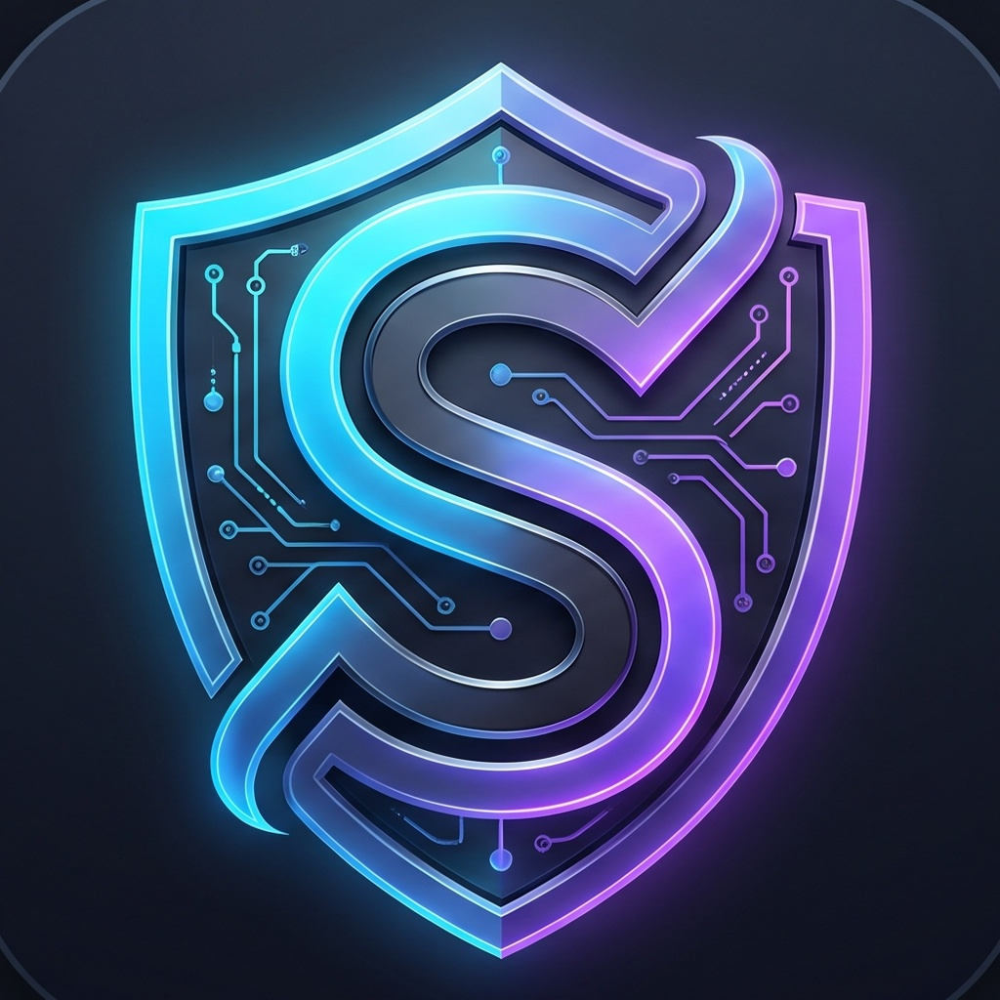
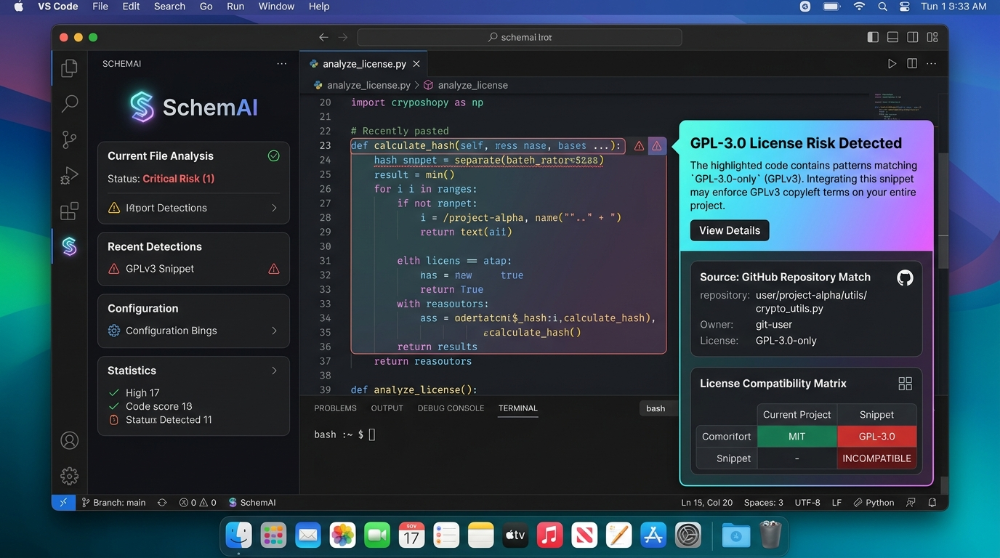
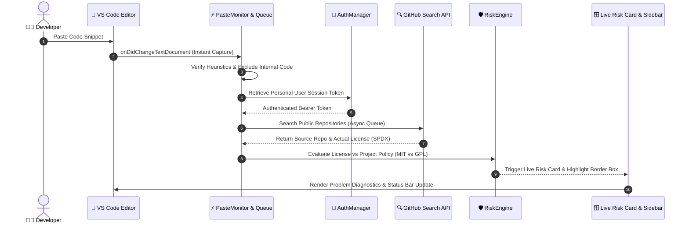
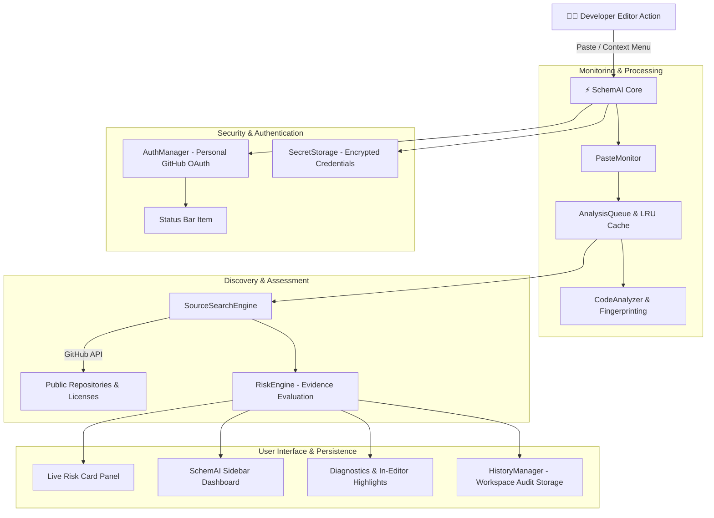

# SchemAI - Smart External Code & License Risk Analyzer

🌐 **Language / اللغة / Idioma:**  
[🇬🇧 English](README.md) | [🇦🇪 العربية](README_AR.md) | [🇪🇸 Español](README_ES.md)

---



## 🧰 Technology Stack & Ecosystem Compatibility

| Component / Spec | Version / Details | Status |
| :--- | :--- | :--- |
| **VS Code Engine** | `^1.75.0+` |  |
| **Runtime Environment** | Node.js `18.x` / `20.x` / `22.x` |  |
| **Language & Compiler** | TypeScript `^4.9.5` |  |
| **Testing Framework** | Mocha `^10.8.2` |  |
| **Packaging Tool** | VSCE `^4.0.0` |  |
| **CI/CD Automation** | Multi-Platform GitHub Actions |  |
| **License** | MIT License |  |

### 🔤 Supported Programming Languages & Activation Triggers
The extension activates dynamically when working with any of the following languages:
* 🟨 **JavaScript** (`onLanguage:javascript`)
* 🟦 **TypeScript** (`onLanguage:typescript`)
* 🐍 **Python** (`onLanguage:python`)
* ☕ **Java** (`onLanguage:java`)
* 🟣 **C#** (`onLanguage:csharp`)
* 🐹 **Go** (`onLanguage:go`)
* ⚙️ **C++** (`onLanguage:cpp`)
* 🦀 **Rust** (`onLanguage:rust`)

---

## 📋 About SchemAI
**SchemAI** is an intelligent Visual Studio Code extension designed to detect, analyze, and audit external source code pasted from third-party repositories. It evaluates legal risks, detects license compatibility issues (e.g. strict copyleft GPL-3.0 inside permissive MIT projects), and offers actionable developer guidance to protect software projects from intellectual property conflicts.

---

## 👥 SchemAI Team

* **Ahmet Asaad Hammoud**
* **Alexander Roldán Palomino**
* **David Vilaseca Pareja**
* **Abdul Rafey Hussain Parveen**
* **Sergio Bueno Gómez**
* **Leon Skalczynski**
* **Yunus Emre Köroğlu**
* **Yusuf Mahdy Mamdouh**

---

## 🖼️ UI & Visual Overview



---

## 📊 System Architecture & Workflow

### 1. Non-Blocking Paste Detection & Analysis Workflow



---

### 2. Modular Architecture Diagram



---

## 🚀 Key Features

* **🔑 Personal GitHub Authentication:** Users authenticate with their personal GitHub account via official VS Code OAuth (`vscode.authentication`). Zero shared developer credentials.
* **🛡️ Non-Blocking Asynchronous Queue:** Real-time paste detection without editor latency, featuring automated debouncing and SHA-256 fingerprint deduplication.
* **🪟 Live Interactive Risk Card:** Side-by-side floating inspection card featuring gradient risk alerts, source repository details, and a color-coded License Compatibility Matrix.
* **📊 Cyberpunk Sidebar Dashboard:** Dedicated Activity Bar panel displaying current file status, recent detections, configuration shortcuts, and audit statistics.
* **🖱️ Editor Context Menu Integration:** Instant right-click actions:
  * `SchemAI: Analyze Selected Code`
  * `SchemAI: Check Last Pasted Code Risk`
  * `SchemAI: View Paste & License History (Audit Log)`
* **📁 Persistent Workspace Audit Log:** Bounded storage tracking past paste analyses, allowing developers to review and mark alerts as False Positives.
* **🔎 Evidence-Based License Detection:** Queries verified repository licenses (`spdx_id`) instead of relying on naive string assumptions.

---

## ⚙️ Building & Testing

### Run Unit Tests & Performance Benchmarks
```bash
npm test
```

### Build & Package Extension (.vsix)
```bash
npm run package
```

### Automated Release
```bash
# Minor release (e.g. 0.1.0 -> 0.2.0)
npm run release

# Patch release (e.g. 0.1.0 -> 0.1.1)
npm run release:patch
```
