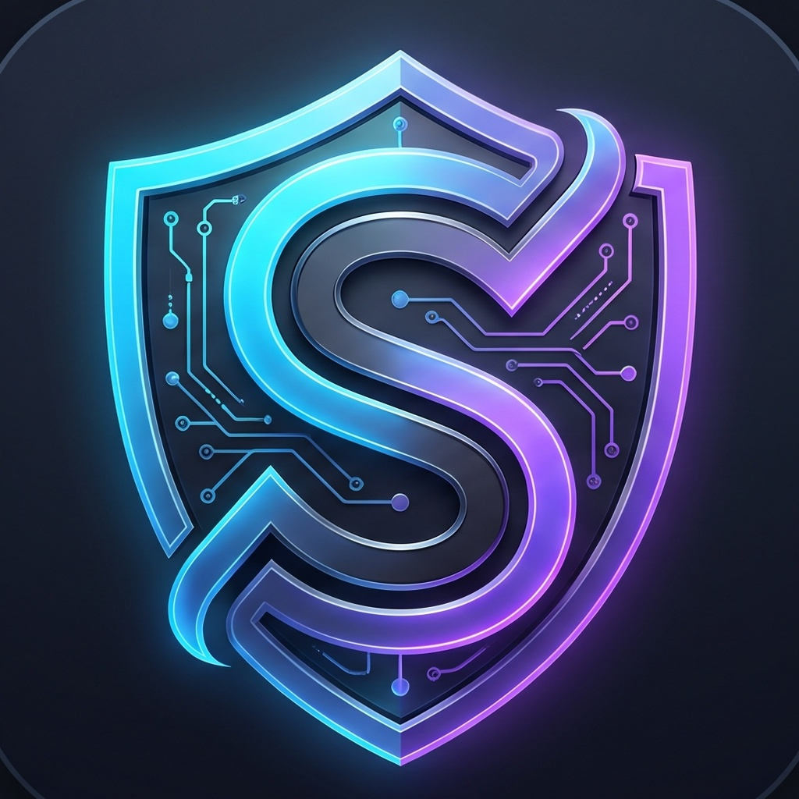
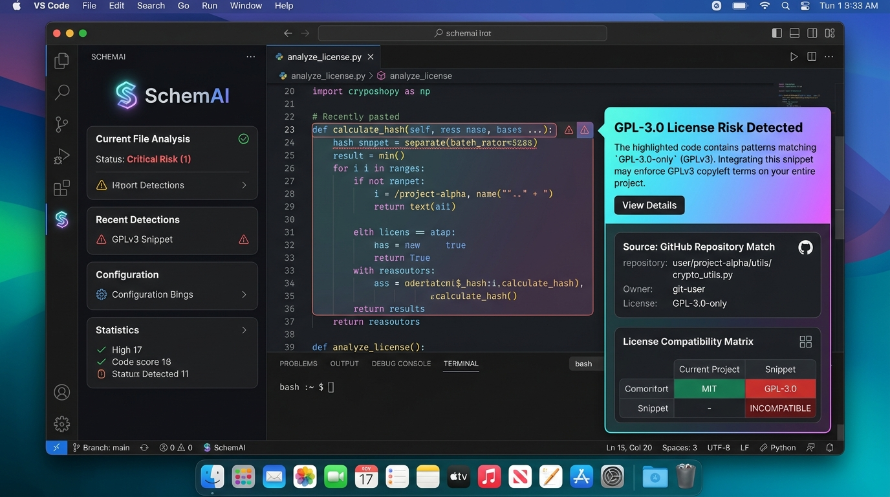
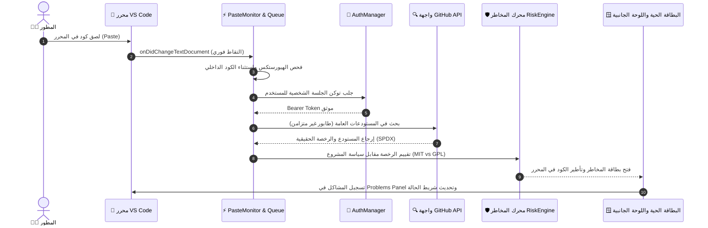
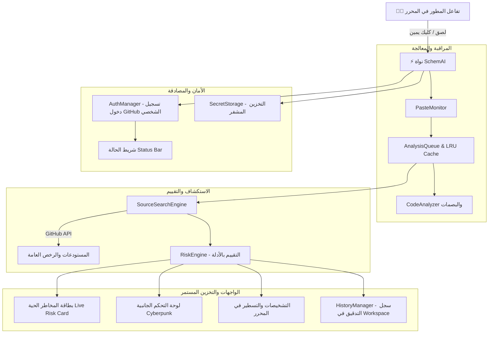

# SchemAI - محلل الأكواد الخارجية ومخاطر تراخيص البرمجيات الذكي

🌐 **Language / اللغة / Idioma:**  
[🇬🇧 English](README.md) | [🇦🇪 العربية](README_AR.md) | [🇪🇸 Español](README_ES.md)

---



## 🧰 الحزمة التقنية والتوافق البيئي

| المكون / المواصفة | الإصدار / التفاصيل | الحالة |
| :--- | :--- | :--- |
| **محرك VS Code** | `^1.75.0+` |  |
| **بيئة التشغيل** | Node.js `18.x` / `20.x` / `22.x` |  |
| **لغة ومترجم المشروع** | TypeScript `^4.9.5` |  |
| **إطار عمل الاختبارات** | Mocha `^10.8.2` |  |
| **أداة التحزيم** | VSCE `^4.0.0` |  |
| **الأتمتة و CI/CD** | GitHub Actions متعدد المنصات |  |
| **الترخيص** | رخصة MIT |  |

### 🔤 لغات البرمجة المدعومة
تعمل الإضافة وتتفعل تلقائياً عند التعامل مع أي من اللغات التالية:
* 🟨 **JavaScript** (`onLanguage:javascript`)
* 🟦 **TypeScript** (`onLanguage:typescript`)
* 🐍 **Python** (`onLanguage:python`)
* ☕ **Java** (`onLanguage:java`)
* 🟣 **C#** (`onLanguage:csharp`)
* 🐹 **Go** (`onLanguage:go`)
* ⚙️ **C++** (`onLanguage:cpp`)
* 🦀 **Rust** (`onLanguage:rust`)

---

## 📋 نبذة عن مشروع SchemAI
**SchemAI** هي إضافة ذكية لمحرر **Visual Studio Code** صُممت لرصد وتدقيق الأكواد المنسوخة والملصوقة من مستودعات ومصادر خارجية (مثل GitHub أو Stack Overflow)، مع تقييم المخاطر القانونية وتوافق الرخص (مثل خطر رخص GPL-3.0 المقيدة داخل مشاريع MIT المرنة)، وإرشاد المطور لحماية مشروعه من أي نزاعات ملكية فكرية.

---

## 👥 فريق عمل SchemAI

* **Ahmet Asaad Hammoud**
* **Alexander Roldán Palomino**
* **David Vilaseca Pareja**
* **Abdul Rafey Hussain Parveen**
* **Sergio Bueno Gómez**
* **Leon Skalczynski**
* **Yunus Emre Köroğlu**
* **Yusuf Mahdy Mamdouh**

---

## 🖼️ الواجهة المرئية ولوحة التحكم



---

## 📊 معمارية النظام ومسار العمل

### 1. مسار رصد اللصق والتحليل غير المعطل للمحرر



---

### 2. المخطط المعماري للموديولات



---

## 🚀 أبرز الميزات والوظائف

* **🔑 تسجيل الدخول بحساب GitHub الشخصي:** تسجيل دخول مستقل لكل مستخدم عبر واجهة VS Code الرسمية (`vscode.authentication`) دون الحاجة لأي توكن مشترك.
* **🛡️ طابور معالجة غير متزامن بدون تعليق المحرر:** رصد اللصق في الخلفية بسرعة فائقة مع آلية Debounce وكاش SHA-256 لمنع الاستعلامات المكررة.
* **🪟 بطاقة فحص المخاطر الحية (Live Risk Card):** نافذة عائمة بجانب الكود تتميز بهيدر لوني متدرج، تفاصيل المستودع المصدر، ومصفوفة توافق الرخص بالألوان.
* **📊 لوحة التحكم الجانبية التفاعلية (Cyberpunk Dashboard):** في شريط الأدوات الجانبي لعرض حالة الملف، الاكتشافات الأخيرة، والعدادات الإحصائية.
* **🖱️ قائمة الزر الأيمن في المحرر (Context Menu):** خيارات مباشرة:
  * `SchemAI: Analyze Selected Code` (فحص الكود المحدد)
  * `SchemAI: Check Last Pasted Code Risk` (فحص وتدقيق آخر كود ملصوق)
  * `SchemAI: View Paste & License History (Audit Log)` (فتح سجل وتاريخ التتبع)
* **📁 سجل تدقيق دائم ومحلي:** حفظ أحدث التحليلات في الـ Workspace مع إمكانية تعليم التنبيهات كإنذار خاطئ (`False Positive`).
* **🔎 كشف الرخص بالدليل وتفادي الإنذار الخاطئ:** التحقق من رخصة المستودع المعتمدة (`spdx_id`) واستثناء الكود الداخلي للمشروع والمستودع الخاص.

---

## ⚙️ التجميع والاختبارات

### تشغيل اختبارات الوحدة والـ Benchmark
```bash
npm test
```

### بناء حزمة الإضافة الرسمية (.vsix)
```bash
npm run package
```

### النشر والأتمتة (Release)
```bash
# إصدار Minor جديد (مثلاً: 0.1.0 -> 0.2.0)
npm run release

# إصدار Patch تصحيحي (مثلاً: 0.1.0 -> 0.1.1)
npm run release:patch
```
