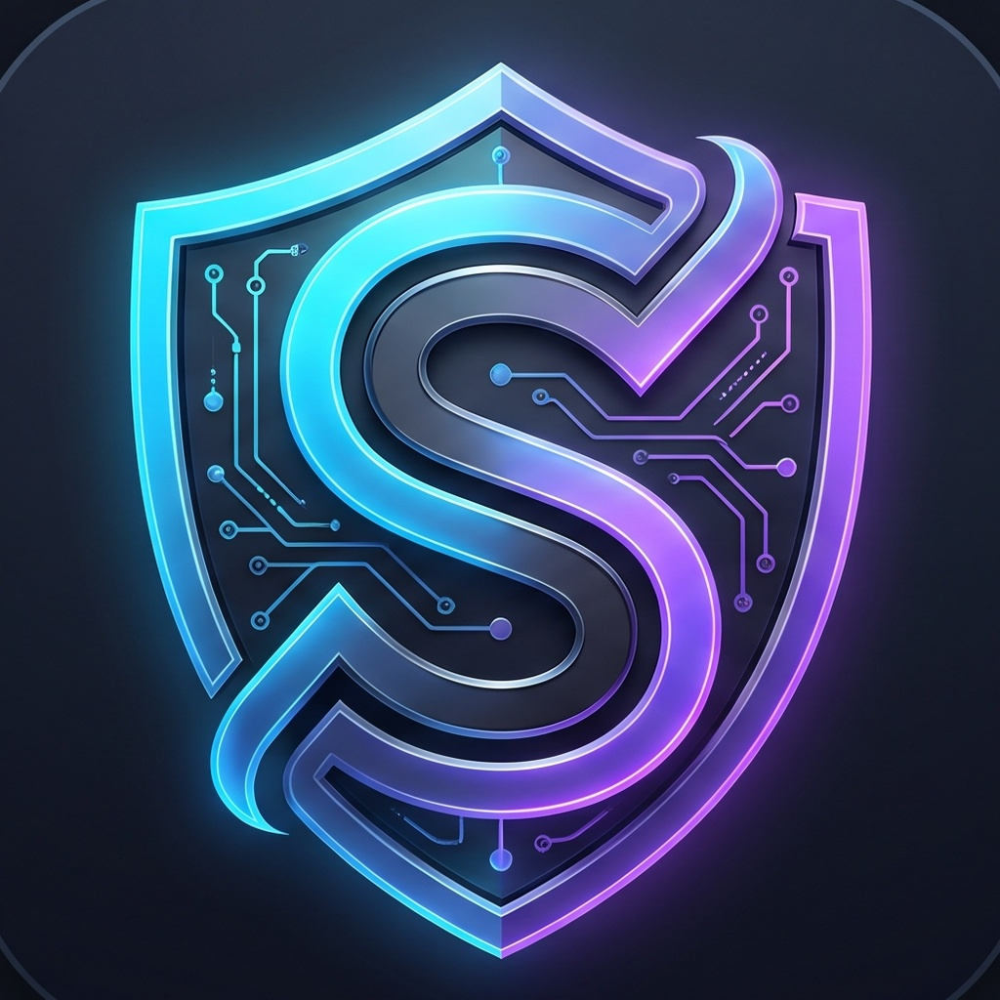
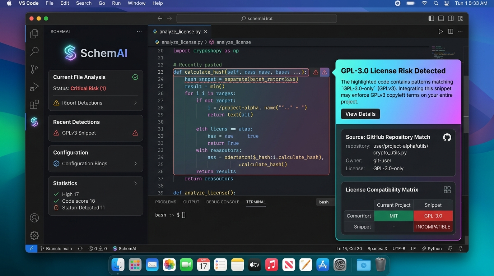
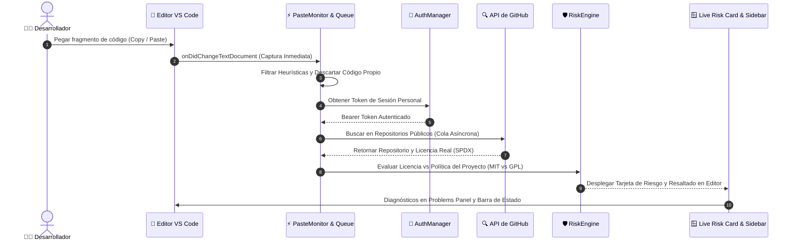
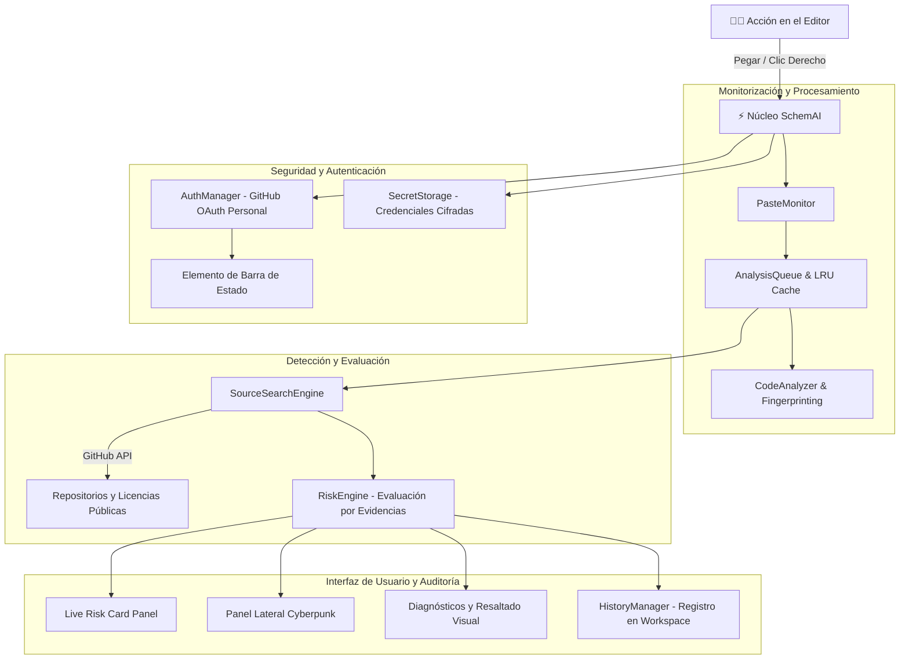

# SchemAI - Analizador Inteligente de Código Externo y Riesgo de Licencias

🌐 **Language / اللغة / Idioma:**  
[🇬🇧 English](README.md) | [🇦🇪 العربية](README_AR.md) | [🇪🇸 Español](README_ES.md)

---



## 🧰 Stack Tecnológico y Compatibilidad

| Componente / Especificación | Versión / Detalles | Estado |
| :--- | :--- | :--- |
| **Motor de VS Code** | `^1.75.0+` |  |
| **Entorno de Ejecución** | Node.js `18.x` / `20.x` / `22.x` |  |
| **Lenguaje y Compilador** | TypeScript `^4.9.5` |  |
| **Framework de Pruebas** | Mocha `^10.8.2` |  |
| **Herramienta de Empaquetado** | VSCE `^4.0.0` |  |
| **Automatización CI/CD** | GitHub Actions Multi-Plataforma |  |
| **Licencia** | Licencia MIT |  |

### 🔤 Lenguajes Soportados y Activación Dinámica
La extensión se activa automáticamente al trabajar con:
* 🟨 **JavaScript** (`onLanguage:javascript`)
* 🟦 **TypeScript** (`onLanguage:typescript`)
* 🐍 **Python** (`onLanguage:python`)
* ☕ **Java** (`onLanguage:java`)
* 🟣 **C#** (`onLanguage:csharp`)
* 🐹 **Go** (`onLanguage:go`)
* ⚙️ **C++** (`onLanguage:cpp`)
* 🦀 **Rust** (`onLanguage:rust`)

---

## 📋 Sobre SchemAI
**SchemAI** es una extensión inteligente para **Visual Studio Code** diseñada para detectar, analizar y auditar código fuente pegado desde repositorios externos (como GitHub o Stack Overflow). Evalúa el riesgo legal y la compatibilidad de licencias (ej. GPL-3.0 copyleft estricto dentro de proyectos MIT permisivos), guiando al desarrollador para proteger su software de conflictos legales.

---

## 👥 Equipo de Trabajo (SchemAI Team)

* **Ahmet Asaad Hammoud**
* **Alexander Roldán Palomino**
* **David Vilaseca Pareja**
* **Abdul Rafey Hussain Parveen**
* **Sergio Bueno Gómez**
* **Leon Skalczynski**
* **Yunus Emre Köroğlu**
* **Yusuf Mahdy Mamdouh**

---

## 🖼️ Interfaz de Usuario y Vista Previa



---

## 📊 Arquitectura del Sistema y Flujo de Trabajo

### 1. Flujo de Captura y Análisis Asíncrono no Bloqueante



---

### 2. Diagrama de Arquitectura Modular



---

## 🚀 Características Principales

* **🔑 Autenticación Personal con GitHub:** Inicio de sesión independiente para cada usuario mediante la API oficial de VS Code (`vscode.authentication`). Sin tokens compartidos del desarrollador.
* **🛡️ Cola Asíncrona sin Bloqueo del Editor:** Análisis en segundo plano sin ralentizar la escritura, con debouncing y deduplicación de huellas SHA-256.
* **🪟 Tarjeta de Riesgo Interactiva en Vivo:** Panel flotante adyacente con degradado neón, detalles del repositorio de origen y Matriz de Compatibilidad de Licencias con código de colores.
* **📊 Panel Lateral Dashboard Cyberpunk:** Vista dedicada en el Activity Bar con estado del archivo actual, detecciones recientes, accesos de configuración y estadísticas.
* **🖱️ Menú Contextual del Editor (Clic Derecho):** Acciones directas integradas:
  * `SchemAI: Analyze Selected Code`
  * `SchemAI: Check Last Pasted Code Risk`
  * `SchemAI: View Paste & License History (Audit Log)`
* **📁 Historial Persistente de Auditoría:** Almacenamiento acotado en el Workspace para revisar análisis previos y marcar falsos positivos.
* **🔎 Detección de Licencias por Evidencias:** Consulta de licencias verificadas (`spdx_id`) evitando falsos positivos al copiar código propio.

---

## ⚙️ Compilación y Pruebas

### Ejecutar Pruebas Unitarias y Benchmarking
```bash
npm test
```

### Empaquetar Extensión (.vsix)
```bash
npm run package
```

### Publicación y Lanzamiento Automatizado
```bash
# Lanzamiento Minor (ej. 0.1.0 -> 0.2.0)
npm run release

# Lanzamiento Patch (ej. 0.1.0 -> 0.1.1)
npm run release:patch
```
