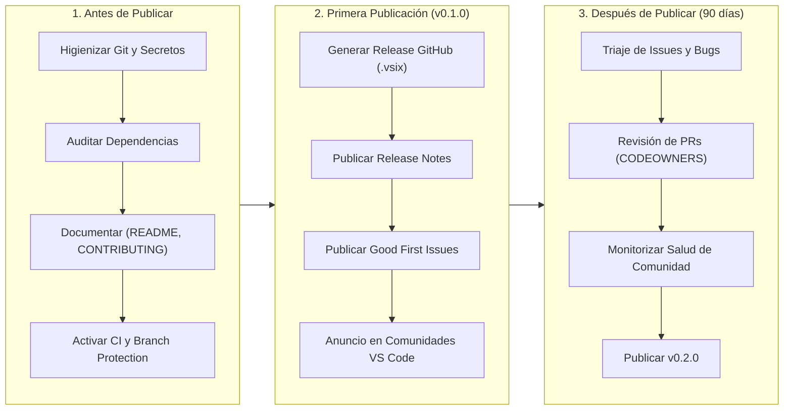

# Plan Común de Lanzamiento Open Source
**Documento:** `open-source-launch-plan.md`  
**Entregable Común:** Todo el Equipo (Ahmet, Alexander, David, Abdul, Leon, Yusuf, Sergio, Yunus)  
**Asignatura:** Gestión de Proyectos Software — Práctica P9  
**Proyecto:** SchemAI — External Code & License Risk Analyzer (VS Code Extension)  
**Fecha:** Noviembre 2026  

---

## 1. Actividad 1: Análisis Inicial del Proyecto (Visión Compartida)

Tras la sesión conjunta de análisis entre los 8 integrantes del equipo, se ha consensuado la siguiente visión común:

### 1.1. ¿Por qué queremos abrir el proyecto?
SchemAI es un analizador de riesgos de propiedad intelectual y licencias en el editor del programador. La propia naturaleza de la herramienta exige **transparencia absoluta**: los desarrolladores y las organizaciones solo confiarán en una herramienta que analiza su código fuente si pueden auditar de forma independiente cómo se procesa dicho código y comprobar que no existe telemetría invasiva ni filtración de propiedad intelectual hacia servidores externos. Además, el ecosistema de licencias y repositorios públicos es tan vasto que únicamente la colaboración abierta permite mantener actualizadas las heurísticas y la base de datos de compatibilidad legal.

### 1.2. ¿Qué tipo de comunidad o colaboradores queremos atraer?
- **Desarrolladores y usuarios activos de VS Code:** Para validar el flujo de trabajo diario de pegado y selección en lenguajes populares (TypeScript, Python, Java, Go, Rust, C++).
- **Mantenedores de proyectos Open Source:** Interesados en evitar contaminación por copyleft (ej. licencias GPL en proyectos MIT/Apache).
- **Expertos en licenciamiento libre y juristas tecnológicos:** Que puedan corregir y refinar la matriz de compatibilidad de licencias y excepciones legales.
- **Contribuidores primerizos (*first-time contributors*):** Aprovechando la modularidad estricta de la extensión para ofrecer tareas accesibles (*good first issues*).

### 1.3. ¿Qué partes del proyecto se publicarán y cuáles deberían quedar fuera?
- **Se publican:**
  - El núcleo de la extensión (`src/core/`).
  - Los analizadores sintácticos y de huellas digitales (`src/analysis/`).
  - El conector con la API de búsqueda de GitHub (`src/search/`).
  - El motor de compatibilidad de licencias SPDX (`src/licenses/`).
  - El sistema de diagnósticos en el editor, decoraciones y tarjeta Webview (`src/alerts/`).
  - La gestión de configuración y políticas (`src/config/`).
  - El módulo de autenticación segura y almacenamiento de secretos (`src/auth/`, `src/security/`).
  - El cliente de red con control de rate-limit (`src/network/`).
- **Quedan fuera (Retenidas o Excluidas):**
  - El prototipo del dashboard lateral complejo estilo cyberpunk (HU-16), por considerarse inmaduro y generador de deuda técnica en la primera versión.
  - El módulo de explicaciones con LLM (HU-14), hasta que no se estandarice una pasarela de claves de API segura.
  - Secretos de despliegue, tokens de empaquetado (`OVSX_PAT`) y archivos de entorno local (`.env`).

### 1.4. ¿En qué estado de madurez se encuentra el proyecto?
El proyecto se encuentra en **fase de desarrollo del Sprint 1 (versión v0.1.0 pre-lanzamiento)**. Tras validar la viabilidad con un prototipo funcional en la rama `prototype` (`main`), la arquitectura se ha reinicializado en la rama `develop` bajo un modelo de desacoplamiento modular estricto y desarrollo guiado por pruebas (TDD). Las capacidades de detección léxica, consulta a GitHub y diagnósticos visuales están probadas, pero la experiencia de usuario y la documentación comunitaria requieren consolidación antes del lanzamiento público general.

### 1.5. ¿Qué dificultades podría encontrar una persona externa que quisiera utilizarlo o contribuir?
1. **Dificultad de uso:** Si el usuario no conecta una cuenta de GitHub, las limitaciones de tasa de peticiones públicas de GitHub (60 peticiones/hora) pueden agotar el servicio rápidamente al analizar código con frecuencia.
2. **Dificultad de contribución:** Comprender el ciclo de vida de una extensión de VS Code y la API de extensiones (`ExtensionContext`, `DiagnosticCollection`, `WebviewPanel`) si el desarrollador no tiene experiencia previa en desarrollo para VS Code.
3. **Complejidad de pruebas:** Probar la extensión de forma interactiva requiere ejecutar una instancia de depuración de VS Code (*Extension Development Host*), lo que exige una guía de configuración clara en `CONTRIBUTING.md`.

---

## 2. Actividad 3: Integración y Plan de Lanzamiento

A partir de las conclusiones de los 4 sub-equipos (Estrategia, Técnica, Comunidad y Gobernanza), se define el **Roadmap Oficial de Apertura**:

### 2.1. Roadmap de Apertura

| Momento | Tareas Específicas y Responsables | Criterio de Éxito |
|---|---|---|
| **Antes de Publicar** *(T-15 a T-1 días)* | 1. Escaneo exhaustivo de secretos en el historial Git (`trufflehog`) y revocación preventiva de tokens de prueba (Equipo B). 2. Verificación de licencia MIT en todo el árbol de código (Equipo C). 3. Redacción de `README.md`, `CONTRIBUTING.md`, `CODE_OF_CONDUCT.md` y plantillas de issues (Equipo C). 4. Configuración de protección de ramas en GitHub (`develop` y `main`: PR obligatorio, 1 aprobación, CI en verde) (Equipo D). 5. Consolidación de la suite de pruebas unitarias con mocks de red (Equipo B). | Repositorio limpio, 100% de tests pasando en CI, documentación completa y gobernanza activada. |
| **Primera Publicación** *(Día del Lanzamiento)* | 1. Generación del tag formal `v0.1.0` y publicación del Release en GitHub adjuntando el binario empaquetado `schema-ai-0.1.0.vsix` (Ahmet). 2. Publicación de 3 tareas etiquetadas como `good first issue` en el issue tracker (David / Abdul). 3. Anuncio inicial en foros especializados de desarrollo (Reddit r/vscode, Twitter/X, foros de software libre) (Equipo A). 4. Activación de GitHub Discussions para soporte de la comunidad (Equipo C). | Release público accesible, binario descargable y primeros hilos de discusión abiertos. |
| **Después de Publicar** *(Primeros 90 días)* | 1. Triaje de issues con tiempo de respuesta inferior a 48 horas (Rotación semanal entre los 8 miembros). 2. Gestión y revisión rigurosa de PRs externos conforme a las reglas de CODEOWNERS (Steering Committee). 3. Monitorización periódica de los 4 indicadores de salud del proyecto (Yunus / Ahmet). 4. Publicación mensual de releases menores con correcciones de compatibilidad de licencias. | Ratio de cierre de bugs > 80%, al menos 2 contribuidores externos activos y cero vulnerabilidades críticas reportadas. |

---

### 2.2. Indicadores de Salud del Proyecto

Se seleccionan **cuatro indicadores cuantitativos y cualitativos** para monitorizar la vitalidad del proyecto:

| Indicador | Qué Permite Detectar | Umbral de Alarma | Posible Actuación si Empeora |
|---|---|---|---|
| **1. Tiempo de Primera Respuesta a Issues (*First Response Time*)** | Detección de una comunidad desatendida o abandono de los mantenedores, lo que desmotiva a nuevos usuarios. | > 48 horas laborables sin respuesta de un miembro del equipo. | Establecer un rol de mantenedor de guardia semanal rotatorio entre las 4 parejas de trabajo para garantizar respuesta rápida. |
| **2. Concentración de Contribuciones (*Bus Factor / Commits Ratio*)** | Dependencia excesiva de una o dos personas para el avance del código, lo que eleva el riesgo de parálisis si alguien se desvincula. | Más del 70% de los commits o revisiones concentrados en un solo desarrollador durante un mes. | Obligar al reparto de asignación de PRs según la matriz de CODEOWNERS e incentivar el trabajo de la pareja de soporte (*shadowing*). |
| **3. Nuevos Colaboradores Externos por Mes (*New Contributors*)** | Dificultad para atraer comunidad externa o barreras de entrada excesivas en el proceso de desarrollo. | 0 nuevos colaboradores externos durante más de 60 días tras el lanzamiento público. | Simplificar la guía `CONTRIBUTING.md`, publicar nuevas tareas `good first issue` y mejorar las herramientas de mock para desarrollo local sin tokens. |
| **4. Ratio de Falsos Positivos Reportados (*False Positive Rate*)** | Inexactitud del motor de similitud o de la matriz de licencias, generando frustración y desinstalación de la extensión. | > 30% de los issues reportados corresponden a falsos positivos en código genérico. | Elevar el umbral de similitud en `src/search/` (de 70% a 75%), aumentar el número de tokens requeridos de 4 a 6 y añadir un comando de exclusión rápida por archivo. |

---

## 3. Actividad 4: Cierre y Preguntas Críticas de Viabilidad

El equipo conjunto responde y justifica las cuatro cuestiones críticas de cierre:

### 3.1. ¿Está el proyecto preparado para publicarse hoy? Justificad la respuesta.
**Respuesta:** **NO, aún no está preparado para una publicación pública abierta.**  
*Justificación técnica y operativa:*
1. Aunque contamos con una arquitectura modular limpia y un prototipo funcional en `main`, la rama oficial de desarrollo `develop` se encuentra aún completando la integración del Sprint 1 (versión v0.1.0).
2. Es obligatorio realizar una auditoría de seguridad previa para purgar cualquier rastro histórico de tokens locales (como el `.env` de pruebas) y asegurar que ningún secreto pueda ser extraído por herramientas automatizadas al abrir el repositorio.
3. Faltan por subir las plantillas de incidencias (`.github/ISSUE_TEMPLATE/`) y el archivo formal `CONTRIBUTING.md` para evitar que la llegada de usuarios externos sature el repositorio sin pautas claras.

### 3.2. ¿Cuál es el principal riesgo de abrirlo en su estado actual?
**Respuesta:** El principal riesgo es **la pérdida de confianza por saturación de cuota de la API de GitHub y falsos positivos tempranos.**  
Si un número elevado de usuarios instala la extensión en su estado actual sin una cuenta de GitHub vinculada, alcanzarán rápidamente el límite de 60 peticiones/hora de la API anónima. La extensión comenzaría a emitir errores HTTP 429/403 continuos o a fallar silenciosamente, provocando valoraciones negativas en el Marketplace y la desinstalación inmediata de la herramienta antes de que podamos demostrar su verdadero valor.

### 3.3. ¿Cuál sería la primera tarea que realizaríais mañana?
**Respuesta:** **Ejecutar el escaneo e higienización de seguridad con `trufflehog` y publicar la rama `develop` protegida con el archivo `CONTRIBUTING.md` y las plantillas de Issues.**  
Esta tarea garantiza que la base de código sea 100% segura frente a fugas de credenciales y establece las reglas del juego para que cualquier contribuidor que observe el repositorio sepa de inmediato cómo reportar errores o clonar el entorno de desarrollo sin romper la arquitectura.

### 3.4. ¿Qué podría provocar que el proyecto fracasara aunque el código estuviese disponible públicamente?
**Respuesta:** El proyecto podría fracasar principalmente por **la falta de utilidad percibida frente a la fricción de uso:**
1. **Fricción por falsos positivos:** Si el desarrollador recibe alertas continuas de código sospechoso sobre bucles triviales o utilidades estándar, percibirá la extensión como *software molesto* (*spam*) y la deshabilitará.
2. **Abandono del mantenimiento post-académico:** Si una vez finalizada la asignatura el equipo deja de responder a los issues y no se han transferido los roles de gobernanza a colaboradores externos activos, el repositorio quedará obsoleto frente a los inevitables cambios de versión de las APIs de VS Code y GitHub.
3. **Falta de visibilidad:** Si no se publicita activamente en canales donde los desarrolladores buscan soluciones de cumplimiento legal de software libre, el código abierto quedará invisible en GitHub sin alcanzar la masa crítica de usuarios necesaria para retroalimentar la base de datos de licencias.

